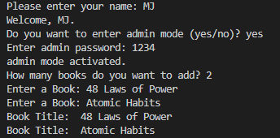
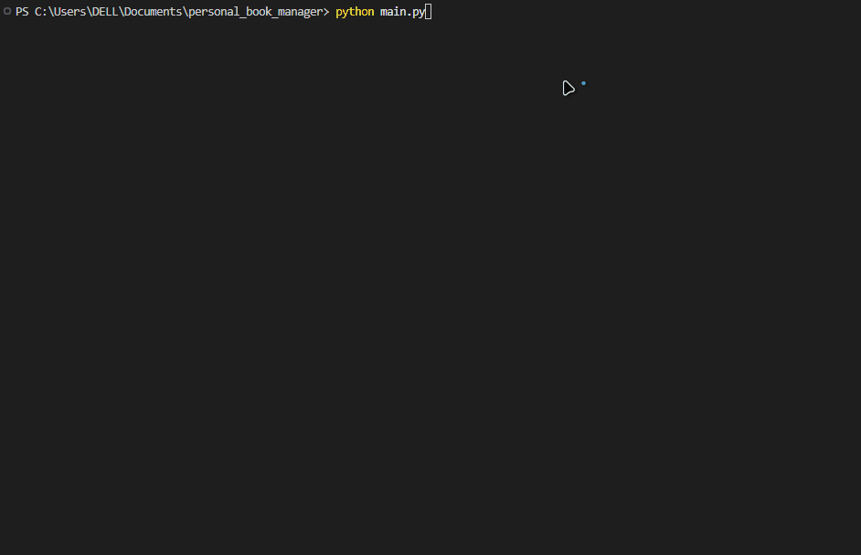

# Personal Task Manager
A simple Personal Book Manager made with Python.


## Features
- Adds multiple Books
- Saves Books
- Loads Saved Books
- Active Admin Mode
  
## Requirements
- Python
- python-dotenv

## Installation
Install the required packages:

```bash
python -m pip install -r requirements.txt
```
## Envoirement Setup
Create a `.env` file in the project folder.

Use `.env.example` as a template.

### Add your admin password

```env
BOOK_MANAGER_ADMIN_PASSWORD=your_password_here
```
Replace `your_password_here` with your own admin password.

## Run the Program
Run the `main.py` file:
```bash
python main.py
```

## Screenshot


## Demo
